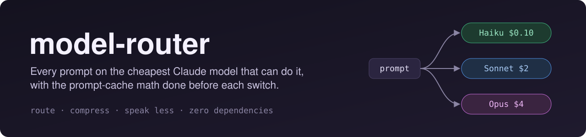
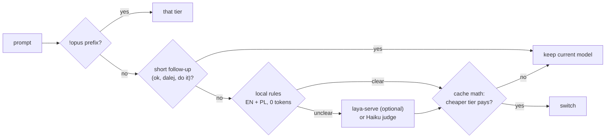

<p align="center">
  <a href="https://github.com/preisnerai/claude-mods/actions/workflows/test.yml"></a>
  <a href="LICENSE"></a>
  
  
</p>

<p align="center"><b>English</b> · <a href="README.pl.md">Polski</a></p>

**model-router** is a Claude Code mod that cuts what a session costs in three places at once:

| | What it does | Where the tokens go |
|---|---|---|
| 🔀 **Route** | Sends each prompt to Haiku, Sonnet or Opus by what it needs. Local rules in English and Polish call clear prompts with no model call; only unclear ones go to a Haiku judge (about $0.0001 each). | Fewer Opus tokens |
| 🧮 **Do the cache math** | Changing model throws away the prompt cache: the next request re-reads the whole conversation at write price. Before every move to a cheaper model the router prices the turn on both models with your actual context size and cache state, and moves only when it pays. | No downgrade costs more than it saves |
| 🗜️ **Compress** | Bash output shrinks before it enters the conversation, rtk-style: no progress bars or passing tests, exact repeats folded into a count, every error kept. File contents, diffs and data pass untouched. The full output is kept on disk. With [rtk](https://github.com/rtk-ai/rtk) installed, the test and type-check runs it parses go through `rtk pipe`. | Less input on every later request |
| ✂️ **Speak less** | One short system-prompt section asks for no preamble, recaps or closers, and for batched commands and partial file reads. `adhd` mode puts the next action first, after [i-have-adhd](https://github.com/ayghri/i-have-adhd). | Fewer output tokens, which cost 5× input |

A **Model router** pane (beside the chat in the desktop app) shows the current model, savings and turns per model, live.

`/router` shows what routing saved in dollars and how many tokens compression kept out of the context, for this session and all time.

## Install

At the prompt of a Claude Code terminal session:

```
/plugin marketplace add preisnerai/claude-mods
/plugin install model-router@claude-mods
```

That's it: no server, no binary, no API key. From a shell: `claude plugin marketplace add preisnerai/claude-mods`, then `claude plugin install model-router@claude-mods`. In the desktop app: **+** next to the prompt box → Plugins → Add marketplace `preisnerai/claude-mods` → Add plugin.

## Why cache-aware routing matters

A router that switches models on every prompt can **cost** you money. Claude's prompt cache belongs to one model: switch, and the next request pays the cache-write price for the whole conversation: 2× input, for the 1-hour entries Claude Code writes. Its system prompt and tools alone run to tens of thousands of tokens, so even a young session has something to lose.

These are the router's own numbers, for a session on Claude Opus 5.5 with a warm cache:

| Context already cached | Opus → Sonnet for a routine task | Opus → Haiku for a quick task |
|---:|---|---|
| 40k tokens | **switches**: saves $0.024 | **switches**: saves $0.047 |
| 100k tokens | **stays on Opus**: switching costs $0.17 more | **switches**: saves $0.051 |
| 150k tokens | **stays on Opus**: switching costs $0.34 more | **stays on Opus**: Haiku's long-context rate makes it $0.063 more |
| 400k tokens | **stays on Opus**: switching costs $1.16 more | **stays on Opus**: $0.23 more |

Opus 5.5 reads cache at $0.20/MTok and Sonnet 5.5 at $0.10 (0.05×), so Sonnet saves on output and on cache reads: a small warm conversation gains from the switch, while a large one pays more to rewrite its cache. Below roughly 50K tokens the Opus → Sonnet switch pays; above it the cache rewrite costs more. Haiku 5.5 is 40× cheaper than Opus on input up to 100K tokens, so dropping to it pays even after the rewrite; past 100K it bills a long-context rate five times higher, and a warm Opus is cheaper again. When a model's cache has lapsed (an hour idle), both sides pay the write and the cheaper model wins. Going back to a model whose cache is still warm costs only what changed since. The cache also belongs to the request's effort, so changing effort rewrites it exactly like changing model; on your own model the router keeps your `/effort` unless a task's own effort costs nothing more.

Harder tasks are about quality, not money: by default the router moves up a tier when a prompt needs it, and shows what the switch cost with the cache re-write. Set `escalate: suggest` to only name the tier in the status line and decide yourself. A `!tier` prefix always switches.

The turn shape behind those numbers (requests per turn, tokens written, how much each request adds to the context) starts from priors per tier and learns from your own finished turns, filed under the tier of the task.

## How a prompt is routed



- **Overrides:** start a prompt with `!haiku`, `!sonnet`, `!opus` (or `!fable`) to force it. `!+` moves one tier up from the current route, `!-` one tier down. The prefix is removed before the model sees the prompt, also while routing is off.
- **Follow-ups** ("ok", "dalej", "do it", or three words the rules don't read) keep the current model. A short prompt the rules do read ("debug flaky test") is routed like any other. A dissatisfied one ("znowu źle", "popraw to", "still wrong") escalates one tier above the current route.
- **Not only code:** the local rules also read translation and text editing, spreadsheets (Excel/CSV), Notion/Confluence, multi-step browser work (Chrome, forms, portals), email, API/automation and agent work. A plain git command (`push`, `commit`, `pull`, `fetch`, `status`) is Haiku; a pull request, force-push, rebase or merge conflict is Sonnet. The size signals matter too: four or more code files, numbered steps, a long brief, a stack trace, or tools that kept failing in the previous turn move the task up.
- **Research is bounded by policy:** a single lookup ("look up the price", "sprawdź cenę") is Haiku; anything broader ("research the market", "zbadaj temat", "porównaj rozwiązania") is Sonnet. Research never goes to Opus; a real failure ("zbadaj wyciek pamięci", "why does it crash") is a debug task, not research.
- **Negations are read:** "don't refactor, just translate", "nie zmieniaj kodu", "bez refaktoryzacji" cancel the verb they sit on, so the task is not routed by a word the person explicitly ruled out.
- **`/model` wins:** change the model by hand and routing stops for the session. `/router on` resumes.
- **Stuck detection:** three failed or identical tool calls in a row move the turn up one tier (or suggest it).
- **Subagents:** a general-purpose subagent that names no model gets the turn's cheaper tier. Other agent types may pin a model in their definition, so they, forks and Opus turns are left alone.
- **Skills** (`/my-skill args`) are routed by what you typed and the command's own description, not by the skill's instructions. Claude Code's own prompt commands (`/code-review`, `/security-review`, `/init`) and MCP prompts run on your `/model`.
- **Prompts typed during a turn** are routed when their own turn starts.
- **Effort per task** (`effortMode: auto`): each tier has a base effort (Haiku `low`, Sonnet `medium`, Opus `high`, Fable `xhigh`, each configurable), and a task moves one step from it: a confident diagnosis, architecture or security task up, a translation or rename down. Desktop shows `xhigh` as **Extra**. The cache belongs to model *and* effort, so a new effort goes through the same cost math as a model switch: on your own model your `/effort` stays while its cache is warm. `effortMode: task` always takes the task's effort, even when the cache rewrite costs more; `effortMode: fixed` uses the tier's effort only. The router never sends `max` or `ultracode` as an effort. Crew workers keep the effort they were registered with.
- **Ultracode** for the hardest tasks (a confident Opus/Fable verdict: architecture, unexplained failure, audit, wide migration, production incident): `suggest` names the `ultracode` keyword in the status line, `auto` adds it to the prompt so Claude Code runs it as a multi-agent workflow (dearer per turn, often done sooner and cheaper overall), `off` says nothing. In Desktop, **Ultracode** is the option above Max in the effort picker; the router automates that switch instead of ever sending Max.
- **Learns from you** (`adapt: on`): a `!tier`, `!+` or `!-` over what the rules picked, a `/model` or `/effort` change right after a routed prompt, and a tool-failure escalation shift that kind of task (its rule, or `judge`) by up to ±2 tiers or effort steps. Corrections fade with a two-week half-life and stay on your machine; `/router` shows them (`learned: translation +1 tier`), `/router reset` clears them.
- **The engine's own fallback** (a refusal or an overload switching the model) pauses routing until the next prompt and does not count as a manual `/model`.

## Crew mode: one orchestrator, three warm workers

By default (`mode: crew`) the main session stays on one orchestrator model (Sonnet by default). It moves there once, at the first prompt, and never again, so its prompt cache is never thrown away. Work that takes several tool calls goes to long-lived workers:

| Worker | Model | Gets |
|---|---|---|
| `worker-haiku` | Haiku 5.5 | searching and reading code, summaries, running commands, mechanical edits |
| `worker-sonnet` | Sonnet 5.5 | clear features and fixes, tests, refactors |
| `worker-opus` | Opus 5.5 | unclear bugs, architecture, security and performance analysis |

Each worker keeps its context between tasks: after its first task the orchestrator sends it the next one with `SendMessage` (a finished worker resumes where it was). Workers do the task themselves (they cannot start agents) and answer with a report of at most 10 lines: paths with line numbers, the command that checks it, what is open. The orchestrator is told to name files rather than paste them into a hand-off, never to read a worker's output file, and to do work of two tool calls or less itself, since a hand-off and a report cost two of its own requests.

- The local rules still read every prompt. One that needs a **stronger** model than the orchestrator reaches it with a one-line hint to hand it over if it takes three or more tool calls. `!haiku …` / `!opus …` delegate the whole prompt; `!fable …` goes to `worker-opus`, as there is no Fable worker.
- If the model starts a second worker of the same model, the mod refuses and names the one to message, unless the old worker's context has grown or gone cold enough that a fresh one is cheaper. A spawn under another name (`worker-opus-2`) always gets past a worker that stopped answering.
- `/router off` turns crew off for the session: no crew section, no spawn checks.
- `/router` counts each worker request against the same request on your own `/model`.

Tested live: two tasks for `worker-haiku` in one session started one worker, reused it through `SendMessage`, and cost $0.0023 in Haiku tokens.

## Bash output compression

| Output | What the model gets |
|---|---|
| `npm test` with 400 passing tests and 1 failure | the failure with its diff, the summary, `(400 passing test lines hidden)`: over 10× smaller |
| `pnpm install`, `docker build`, `pip install` | progress bars and spinners gone, repeated warnings as one line `(×30)` |
| `git push`, `git clone` | no `Counting/Compressing objects` lines |
| a 2,000-line log | its head, its tail, and the error lines from the middle with the two lines after each (their location), up to 200 lines |
| `cat`, `sed -n`, `head`, `grep`/`rg`, `git diff`/`show`/`log -p` (any spelling: `git -C dir`, `--no-pager`, `/bin/cat`, `bash -c`, `xargs cat`), `jq`, `curl`, `docker inspect`, `kubectl get` | **untouched**: file contents, diffs and data the model may quote back into an edit |

Claude Code itself moves very large outputs to a file and shows a 2 KB preview; model-router works on the mid-size ones below that, which otherwise enter the context whole: typical test runs, installs and builds.

Rules it never breaks: lines carrying an error are never dropped, folded or shortened; lines that only look alike are folded only in install and build logs; output under 1,200 characters is left alone; a result that would shrink by less than 10% once its note is added is passed through unchanged; and whatever a result no longer shows is saved whole under `~/.claude/model-router/tee/` (a ring of the last 200 compressed outputs), with the path in the output so the model can `grep` it.

With [rtk](https://github.com/rtk-ai/rtk) on your PATH, plain `cargo test`, `pytest`, `tsc`, `mypy` and `go build` runs go through `rtk pipe` instead (not `--collect-only`, `--showConfig`, `--help` and other modes that print something else). An rtk summary that drops the failures the output shows is refused. Nothing is rewritten, so your permission rules see the command you approved.

## Answer styles

`terse` (default) adds one short section to the end of the system prompt: lead with the answer, no preamble or recap or closing offer, don't echo code back, batch shell commands, read the part of a file you need. It never shortens an explanation you asked for, and confirmations before destructive actions stay.

`adhd` shapes answers for a reader with ADHD, adapted from [i-have-adhd](https://github.com/ayghri/i-have-adhd): next action first, numbered steps, one concrete next step, state restated each turn, real time estimates.

`off` leaves the system prompt alone. Switch with `/router style terse|adhd|off`. A change rewrites the system prompt once, so that one request re-reads the conversation uncached.

## Commands

`/router-help` is the directory: it lists every command and what it is for. The short commands are aliases for the same handlers, so `/router why` and `/router-why` do the same thing.

| | |
|---|---|
| `/router` | route in force, savings this session and all time, switches vs. holds, compression totals |
| `/router-help` | the directory: every command and why you would use it |
| `/router-start` | check the install and turn routing on with sane defaults |
| `/router-why` | explain the last decision in plain language: the rule or judge, the tier and effort it wanted, whether the cache math kept the current model, and whether Ultracode was suggested |
| `/router-effort [auto\|task\|fixed]` | show the effort policy; set the mode for this session |
| `/router-ultracode [suggest\|auto\|off]` | show or set the Ultracode switch for this session |
| `/router-cache` | cache hit rate, cache reads/writes and the warm entries with their age |
| `/router-budget [usd\|off]` | show or set a session budget; warns at 80%, can downgrade one tier at 100% |
| `/router-compact [on\|off\|now]` | auto-compact the session with the cheap model at the tier threshold |
| `/router-log` | the last 50 routing decisions as JSON lines, for tuning |
| `/router-panel` | open the live pane |
| `/router-style terse\|adhd\|off` | answer style for this session |
| `/router-off` · `/router-on` | stop or resume routing (or crew) for this session |
| `/router-reset` | clear all-time totals, learned turn profiles, learned corrections and the decision log |

The `/router <sub>` forms (`/router why`, `/router log`, `/router off`, `/router on`, `/router style …`, `/router effort …`, `/router ultracode …`, `/router cache`, `/router budget …`, `/router compact …`, `/router start`, `/router help`) work too.

`/router-cache` shows whether the cache is warm and for how long, so a low hit rate or a string of cold starts is visible instead of guessed. `/router-budget` is a session guard measured from the router's list-price ledger: at 80% it warns, at 100% `budgetAction: warn` only warns and `downgrade` moves the next task one tier down. It never overrides a forced `!tier` prompt.

**Auto-compact** fires at the end of a turn whose context passed the tier's threshold (Opus and Sonnet at 400k, Haiku at 600k tokens by default). The summary is written by the cheap model (`haiku`, also manually with `/compact haiku <notes>`), so the next request re-caches a short summary instead of re-warming the whole transcript on the expensive model. The last few messages are kept word for word, and a failed summary leaves the transcript alone rather than falling through to core compaction.

| Setting | Default | |
|---|---|---|
| `compactAuto` | `true` | auto-compact at the tier threshold; the summary is lossy |
| `compactModel` | `haiku` | the model that writes the summary |
| `compactSonnetAt` / `compactOpusAt` / `compactHaikuAt` / `compactFableAt` | `400k` `400k` `600k` `400k` | context thresholds per tier; `0` disables one tier |
| `compactKeep` | `4` | recent messages kept word for word |
| `compactInstructions` | empty | what the summary should keep or stress |

The status line shows each decision (`router: Sonnet·medium (rule .86) · saved ≈$0.41`), and a note beneath each answer names the model and why, for surfaces with no status line.

`/router why` is the answer to "why is it still on Opus?" or "why did the effort not drop?": it separates a misread task from the cache math. Every decision is also mirrored to `~/.claude/model-router/decisions.json` (the last 500, prompts truncated to 280 characters), so a bad route or a bad effort can be copied into `tests/classify.test.ts` as a labelled case.

## Settings

Shown when you install, and later under `/config`:

| Setting | Default | |
|---|---|---|
| `mode` | `crew` | `route`: one session that switches models when the cache math pays, no workers |
| `orchestrator` | `sonnet` | the main session's model in crew mode |
| `escalate` | `auto` | `suggest`: only name a harder tier in the status line |
| `style` | `terse` | `adhd`, `off` |
| `compress` | `true` | Bash output compression |
| `useRtk` | `true` | use `rtk pipe` when the rtk binary is installed |
| `cacheTtl` | `1h` | `5m` if your setup writes 5-minute cache entries (1.25× instead of 2×) |
| `judge` | `haiku` | `off`: no Haiku judge; unclear prompts go to laya-serve when `layaUrl` is set, and otherwise keep the current model |
| `layaUrl` | empty | a running [laya-serve](https://github.com/NandhaKishorM/laya) classifies unclear prompts locally, before the judge |
| `layaApiKey` | empty | sent to laya-serve as a Bearer token |
| `enableFable` | `false` | route proofs and new theories to Claude Fable 5.1 |
| `haikuEffort` … `fableEffort` | `low` `medium` `high` `xhigh` | base effort per tier; Desktop calls `xhigh` Extra. Never `max` or Ultracode |
| `effortMode` | `auto` | effort per task within the tier, when the cache math allows; `task`: always take the task's effort, even at a cache cost; `fixed`: the tier's effort |
| `workerCacheTtl` | `5m` | subagent/workflow cache TTL for the worker reuse math; `1h` only if you also set `subagentPromptCacheTtl` to 1h |
| `budgetUsd` | `0` | session budget in USD; `0` is off |
| `budgetAction` | `warn` | at 100%: `warn` only warns, `downgrade` moves the next task one tier down |
| `ultracode` | `suggest` | `auto`: add `ultracode` to the hardest prompts; `off` |
| `adapt` | `on` | learn routing shifts from `!tier`, `!+`, `!-`, `/model` and `/effort` corrections; `off` |
| `showNote` | `true` | the line beneath each answer |

Model ids per tier are at the top of [`model-router/hooks/register.ts`](model-router/hooks/register.ts). On Bedrock or Vertex, put your provider's ids there.

## FAQ

**Is the "saved" figure real?** It is an estimate at list prices, and it covers routing only (compression is reported in tokens kept out of the context, and the shorter answers are not measured). Every main-loop request is priced twice: as it ran, and as it would have run on your own `/model` with that model's own cache, as if every request had gone there. So a switch's cache write counts against the savings, and so does re-warming your model after a routed stretch. The judge's cost is subtracted too. Crew workers are compared with the same requests on your `/model`. Subscription plans don't bill per token, but the same tokens count against your usage limits.

**Does compression break the prompt cache?** No. Output is shrunk once, before it is stored, so every later request sends the same small text and caches it normally.

**Does the style section break the cache?** It is added once at session start and stays the same, so it is cached with the rest of the system prompt. Only changing the style mid-session costs one uncached request.

**What about privacy?** Routing and compression run inside Claude Code. The only requests the mod makes are the Haiku judge on your own account (for unclear prompts, unless `judge: off`) and laya-serve if you set it up. It also runs `rtk` locally when installed, and keeps the last 200 full Bash outputs under `~/.claude/model-router/tee/`.

## More mods in this repo

**[find-mod](find-mod)** (0.1, early): finds Claude Code mods on GitHub. `/find-mod what you need` searches the `claude-mod`, `claude-code-mod` and `claude-code-plugin` topics, has Haiku rate each match, and picks the best match with the most stars. `/find-mod install owner/repo` previews first and installs only with `--yes`. Install it with `/plugin marketplace add preisnerai/claude-mods`, then `/plugin install find-mod@claude-mods`. Details in [Polish](README.pl.md#find-mod).

To make your own mod findable: add the `claude-mod` topic and a `.claude-plugin/marketplace.json` to its repository.

## Credits

- [laya-router](https://github.com/marcreichel/laya-router) by Marc Reichel (MIT): the idea of routing on a classifier and the cost of switching mid-session, `/model` taking precedence, stuck detection, the calibration log, and the laya-serve tier descriptions this mod reuses.
- [rtk](https://github.com/rtk-ai/rtk) by rtk-ai: the output-compression strategies reimplemented here, and the binary this mod calls when it is installed. No rtk code is included.
- [i-have-adhd](https://github.com/ayghri/i-have-adhd) by Ayoub Ghriss (MIT): the rules behind the `adhd` style.
- [haiku-compact](https://github.com/kjhq/haiku-compact) (MIT): the compaction pattern this mod adapts — summarize the session with Haiku through the `session.compact` hook, keep the recent tail word for word, never fall back to an expensive-model compaction when the summary fails.

## Develop

```bash
claude plugin validate model-router
claude plugin test model-router      # 87 tests: rules, cost model, compression, routing and crew end to end
claude --plugin-dir model-router     # try it in a session
```

## License

[MIT](LICENSE)
