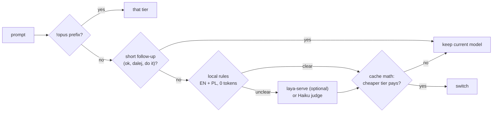

<p align="center">
  <a href="https://github.com/preisnerai/claude-mods/actions/workflows/test.yml"></a>
  <a href="LICENSE"></a>
  
  
</p>

<p align="center"><b>English</b> · <a href="README.pl.md">Polski</a></p>

**model-router** is a Claude Code mod that cuts what a session costs in three places at once:

| | What it does | Where the tokens go |
|---|---|---|
| 🔀 **Route** | Sends each prompt to Haiku, Sonnet or Opus by what it needs. Local rules in English and Polish call clear prompts with no model call; only unclear ones go to a Haiku judge (about $0.0001 each). | Fewer Opus tokens |
| 🧮 **Do the cache math** | Changing model throws away the prompt cache: the next request re-reads the whole conversation at write price. Before every switch the router prices the turn on both models with your actual context size and cache state, and switches only when it pays. | No switch costs more than it saves |
| 🗜️ **Compress** | Bash output shrinks before it enters the conversation, rtk-style: no progress bars or passing tests, repeats folded into a count, every error kept. The full output is kept on disk. With [rtk](https://github.com/rtk-ai/rtk) installed, the commands it knows go through `rtk pipe`. | Less input on every later request |
| ✂️ **Speak less** | One short system-prompt section asks for no preamble, recaps or closers, and for batched commands and partial file reads. `adhd` mode puts the next action first, after [i-have-adhd](https://github.com/ayghri/i-have-adhd). | Fewer output tokens, which cost 5× input |

`/router` shows what it all saved, in dollars, for this session and all time.

## Install

At the prompt of a Claude Code terminal session:

```
/plugin install model-router --marketplace preisnerai/claude-mods
```

Answer `y` to add the marketplace, then pick a scope. That's it: no server, no binary, no API key. From a shell: `claude plugin install model-router --marketplace preisnerai/claude-mods`. In the desktop app: **+** next to the prompt box → Plugins → Add marketplace `preisnerai/claude-mods` → Add plugin.

## Why cache-aware routing matters

A router that switches models on every prompt can **cost** you money. Claude's prompt cache belongs to one model: switch, and the next request pays the cache-write price for the whole conversation: 2× input, for the 1-hour entries Claude Code writes. Its system prompt and tools alone run to tens of thousands of tokens, so even a young session has something to lose.

These are the router's own numbers, for a session on Claude Opus 5.5 with a warm cache:

| Context already cached | Opus → Sonnet for a routine task | Opus → Haiku for a quick task |
|---:|---|---|
| 40k tokens | **stays on Opus**: switching costs $0.12 more | **switches**: saves $0.023 |
| 100k tokens | **stays on Opus**: switching costs $0.35 more | **switches**: saves $0.035 |
| 400k tokens | **stays on Opus**: switching costs $1.49 more | **switches**: saves $0.092 |

Opus 5.5 and Sonnet 5.5 read cache at the same $0.20/MTok, so mid-session Sonnet saves only on output, and writing the conversation into its cache costs more than that. Haiku is 40× cheaper than Opus on input, so dropping to it pays even after the rewrite. When a model's cache has lapsed (an hour idle), both sides pay the write and the cheaper model wins. Going back to a model whose cache is still warm costs only what changed since.

Harder tasks are about quality, not money: by default the router moves up a tier when a prompt needs it, and shows what the switch cost. Set `escalate: suggest` to only name the tier in the status line and decide yourself.

The turn shape behind those numbers (requests per turn, tokens written) starts from priors per tier and learns from your own finished turns.

## How a prompt is routed



- **Overrides:** start a prompt with `!haiku`, `!sonnet`, `!opus` (or `!fable`) to force it. The prefix is removed before the model sees the prompt.
- **`/model` wins:** change the model by hand and routing stops for the session. `/router on` resumes.
- **Stuck detection:** three failed or identical tool calls in a row move the turn up one tier (or suggest it).
- **Subagents** that name no model get the turn's cheaper tier. Forks and Opus turns leave them alone.
- **Skills** (`/my-skill args`) are routed by the skill's expanded text, not just the command name.
- **Effort** follows the tier: Haiku `low`, Sonnet `medium`, Opus `high`, Fable `xhigh`, each configurable.

## Bash output compression

| Output | What the model gets |
|---|---|
| `npm test` with 400 passing tests and 1 failure | the failure with its diff, the summary, `(400 passing test lines hidden)`: over 10× smaller |
| `pnpm install`, `docker build`, `pip install` | progress bars and spinners gone, repeated warnings as one line `(×30)` |
| `git push`, `git clone` | no `Counting/Compressing objects` lines |
| a 2,000-line log | its head, its tail, and every error line from the middle |
| `cat`, `sed -n`, `head`, `git diff`, `git show` | **untouched**: the model may quote it back into an edit |

Claude Code itself moves very large outputs to a file and shows a 2 KB preview; model-router works on the mid-size ones below that, which otherwise enter the context whole: typical test runs, installs and builds.

Rules it never breaks: lines carrying an error are never folded or cut, output under 1,200 characters is left alone, a result that would shrink by less than 10% is passed through unchanged, and the whole output is saved under `~/.claude/model-router/tee/` (a ring of the last 200), with the path in the output so the model can `grep` it.

With [rtk](https://github.com/rtk-ai/rtk) on your PATH, single commands rtk has a parser for (`cargo test`, `pytest`, `tsc`, `vitest`, `mypy`, `prettier`, `phpunit`, `ctest`, `go build`, `grep`/`rg`, `find`/`fd`) go through `rtk pipe` instead. Nothing is rewritten, so your permission rules see the command you approved.

## Answer styles

`terse` (default) adds one short section to the end of the system prompt: lead with the answer, no preamble or recap or closing offer, don't echo code back, batch shell commands, read the part of a file you need. It never shortens an explanation you asked for, and confirmations before destructive actions stay.

`adhd` shapes answers for a reader with ADHD, adapted from [i-have-adhd](https://github.com/ayghri/i-have-adhd): next action first, numbered steps, one concrete next step, state restated each turn, real time estimates.

`off` leaves the system prompt alone. Switch with `/router style terse|adhd|off`. A change rewrites the system prompt once, so that one request re-reads the conversation uncached.

## Commands

| | |
|---|---|
| `/router` | route in force, savings this session and all time, switches vs. holds, compression totals |
| `/router style terse\|adhd\|off` | answer style for this session |
| `/router off` · `/router on` | stop or resume routing for this session |
| `/router log` | the last 50 routing decisions as JSON lines, for tuning |
| `/router reset` | clear all-time totals, learned turn profiles and the log |

The status line shows each decision (`router: Sonnet·medium (rule .86) · saved ≈$0.41`), and a note beneath each answer names the model and why, for surfaces with no status line.

## Settings

Shown when you install, and later under `/config`:

| Setting | Default | |
|---|---|---|
| `escalate` | `auto` | `suggest`: only name a harder tier in the status line |
| `style` | `terse` | `adhd`, `off` |
| `compress` | `true` | Bash output compression |
| `useRtk` | `true` | use `rtk pipe` when the rtk binary is installed |
| `cacheTtl` | `1h` | `5m` if your setup writes 5-minute cache entries (1.25× instead of 2×) |
| `judge` | `haiku` | `off`: local rules only, zero tokens; unclear prompts keep the current model |
| `layaUrl` | empty | a running [laya-serve](https://github.com/NandhaKishorM/laya) classifies unclear prompts locally, before the judge |
| `enableFable` | `false` | route proofs and new theories to Claude Fable 5.1 |
| `haikuEffort` … `fableEffort` | `low` `medium` `high` `xhigh` | effort per tier |
| `showNote` | `true` | the line beneath each answer |

Model ids per tier are at the top of [`model-router/hooks/register.ts`](model-router/hooks/register.ts). On Bedrock or Vertex, put your provider's ids there.

## FAQ

**Is the "saved" figure real?** It is an estimate at list prices: each routed request's token counts priced on the model it ran on and on the model it would have run on, minus what the judge cost. Subscription plans don't bill per token, but the same tokens count against your usage limits.

**Does compression break the prompt cache?** No. Output is shrunk once, before it is stored, so every later request sends the same small text and caches it normally.

**Does the style section break the cache?** It is added once at session start and stays the same, so it is cached with the rest of the system prompt. Only changing the style mid-session costs one uncached request.

**What about privacy?** Routing and compression run inside Claude Code. The only requests the mod makes are the Haiku judge on your own account (for unclear prompts, unless `judge: off`) and laya-serve if you set it up. It also runs `rtk` locally when installed, and keeps the last 200 full Bash outputs under `~/.claude/model-router/tee/`.

## Credits

- [laya-router](https://github.com/marcreichel/laya-router) by Marc Reichel (MIT): the idea of routing on a classifier and the cost of switching mid-session, `/model` taking precedence, stuck detection, the calibration log, and the laya-serve tier descriptions this mod reuses.
- [rtk](https://github.com/rtk-ai/rtk) by rtk-ai: the output-compression strategies reimplemented here, and the binary this mod calls when it is installed. No rtk code is included.
- [i-have-adhd](https://github.com/ayghri/i-have-adhd) by Ayoub Ghriss (MIT): the rules behind the `adhd` style.

## Develop

```bash
claude plugin validate model-router
claude plugin test model-router      # 46 tests: rules, cost model, compression, routing end to end
claude --plugin-dir model-router     # try it in a session
```

## License

[MIT](LICENSE)
