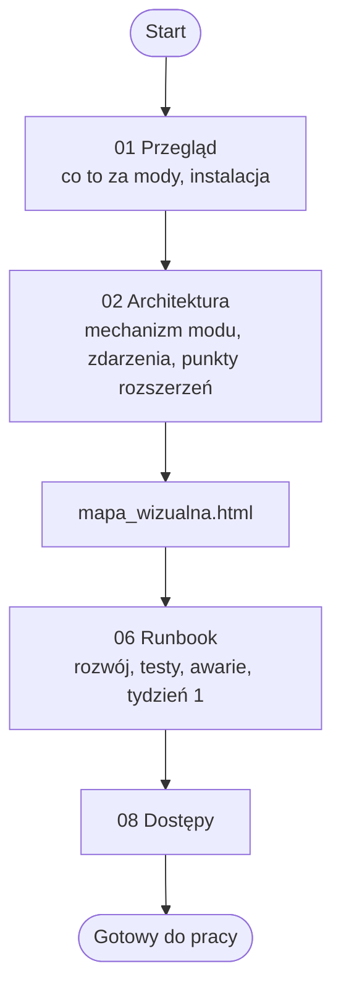

# claude-mods: spis dokumentacji (00_INDEX)

Stan: 2026-11-13. Dokumentacja (`docs/`, `AGENTS.md`, `CLAUDE.md`) jest w repozytorium modów (korzeń repo; gałąź `claude/model-router-1-12-1`, niezacommitowane zmiany modelu-routera); przeniesiona do repo 2026-11-13, jeszcze niezacommitowana (czeka na zgodę właściciela; commit tylko na osobnej gałęzi, nie na `claude/model-router-1-12-1`). Zgodność z kodem pilnuje `docs/docsync.json` (narzędzie `docsync.py`, zasady w `AGENTS.md`). Brak sekretów w dokumentach (`08_DOSTEPY.md`).

## 1. Kolejność czytania

## 2. Dokumenty

| Plik | Co zawiera | Kiedy otworzyć |
|---|---|---|
| [`01_PRZEGLAD.md`](01_PRZEGLAD.md) | dwa mody, jak działają, instalacja, zasady, rozmiar i wyniki testów | pierwszy plik |
| [`02_ARCHITEKTURA_BLUEPRINT.md`](02_ARCHITEKTURA_BLUEPRINT.md) | struktura, mechanizm hooków, cykl promptu `model-router`, crew, `find-mod`, punkty rozszerzeń, CI, ryzyka (diagramy Mermaid) | zmiana kodu, pytanie "dlaczego tak" |
| [`06_RUNBOOK_PRZEKAZANIE.md`](06_RUNBOOK_PRZEKAZANIE.md) | uruchomienie i testy, instalacja, typowe zadania, awarie, stan repo, plan pierwszego tygodnia | przejęcie projektu, awaria |
| [`08_DOSTEPY.md`](08_DOSTEPY.md) | systemy zewnętrzne (GitHub, Actions, Claude Code, laya-serve); pola do uzupełnienia przez właściciela | odzyskiwanie dostępów |
| [`mapa_wizualna.html`](mapa_wizualna.html) | samodzielna strona z diagramami (Mermaid z CDN jsDelivr; bez sieci pokazuje kod diagramu), kliknięcie węzła pokazuje opis | przegląd wizualny |

Dokumentów sprzed doc-sync nie było. Dokumentacja użytkowa modów jest w repozytorium: `README.md` (angielski), `README.pl.md`, `model-router\README.md`, `model-router\ROADMAP.md` (plan dodatków).

## 3. Gdzie szukać odpowiedzi

| Pytanie | Dokument |
|---|---|
| Co robi `model-router` i `find-mod`? | `01` sekcje 1 i 2 |
| Jak zainstalować? | `01` sekcja 3; `06` sekcja 3 |
| Jak działa routing, crew i kompresja? | `02` sekcje 3 i 4; `README.md` |
| Jak działa wyszukiwanie modów? | `02` sekcja 5 |
| Jak dodać komendę, ustawienie, nowy mod? | `02` sekcja 6; `06` sekcja 4 |
| Jak uruchomić testy? | `06` sekcja 2 |
| Co zrobić, gdy coś nie działa? | `06` sekcja 5 |
| Jaki jest stan repozytorium? | `06` sekcja 7 |
| Gdzie są dostępy? | `08` |

## 4. Mapa: kod -> dokument

| Plik lub katalog (względem korzenia repo) | Opisany w |
|---|---|
| `.claude-plugin/marketplace.json`, `.github/workflows/test.yml` | `02` sekcje 1, 7 |
| `model-router/.claude-plugin/plugin.json` | `02` sekcja 3; `01` |
| `model-router/hooks/*.ts`, `register.tsx` | `02` sekcje 3, 4 |
| `model-router/tests/` | `06` sekcje 2, 4 |
| `find-mod/` | `02` sekcja 5 |
| `README.md`, `README.pl.md`, `model-router/README.md`, `ROADMAP.md` | dokumentacja użytkowa (nie weryfikowana tu linia po linii) |
| `.claude/`, `.git/`, `.codegraph`, `.omo` | pominięte (lokalne narzędzia) |

## 5. Konwencje i luki

- Język polski; ścieżki względem korzenia repo; "niezweryfikowane" przy tym, czego nie sprawdzono.
- Po zmianie kodu: `/doc-sync`, potem `python "%USERPROFILE%\.claude\skills\doc-sync\docsync.py" check --root .` (w korzeniu repo). Sekcji `<!-- HUMAN -->` nie zmieniaj samodzielnie.
- Luki: nie opisano pojedynczych funkcji `classify.ts` i `history.ts`; nie czytano wszystkich 2228 linii `register.tsx` (przeczytano rejestrację zdarzeń i komend); proces publikacji wersji i aktualizacji u użytkownika niezweryfikowany.
