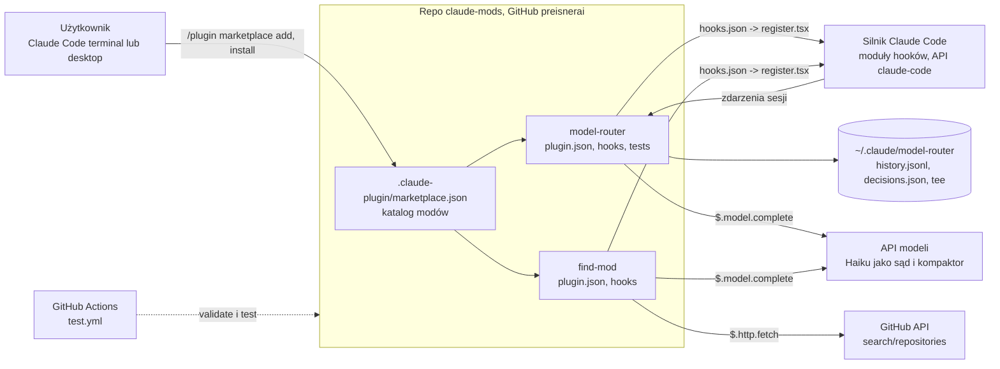
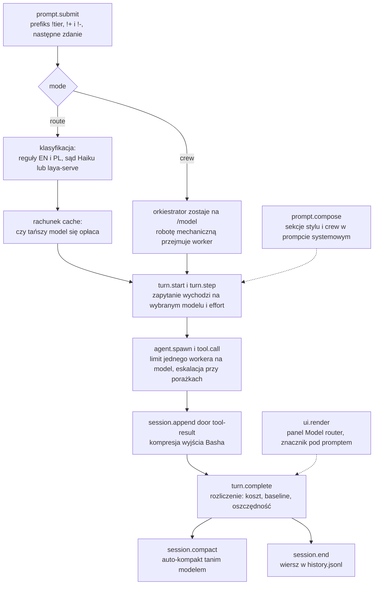
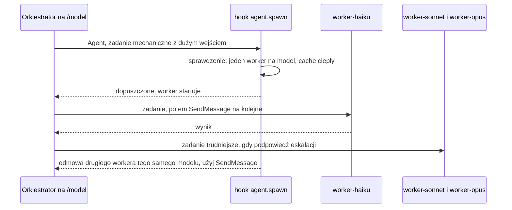
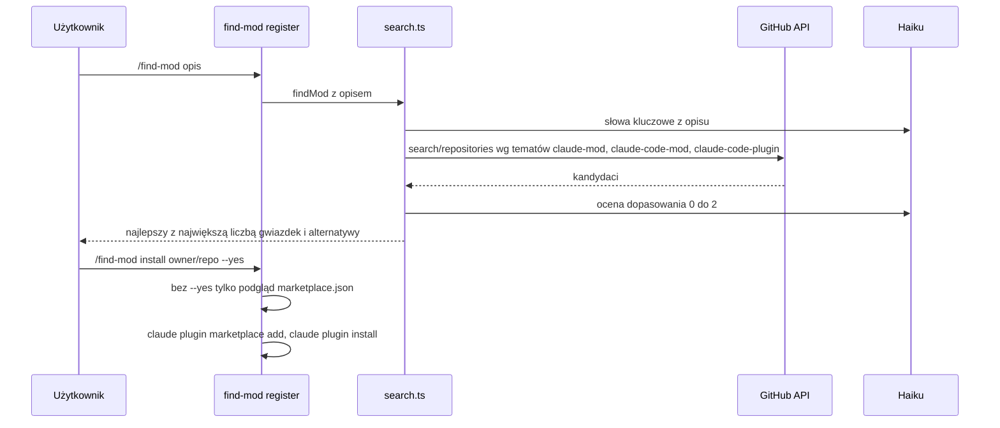

# claude-mods: architektura i blueprint (02)

Opis tego, co jest w katalogu roboczym repo (korzeń repo, dalej "repo modów") na 2026-11-13. Ścieżki względem korzenia repo. Diagramy interaktywne: `mapa_wizualna.html`. Opisy parametrów modu: `model-router/README.md`, `README.md` (angielski), `README.pl.md`.

## 1. Struktura i kontekst

Źródła: `.claude-plugin/marketplace.json`, `*/hooks/hooks.json`, `.github/workflows/test.yml`, `model-router/hooks/register.tsx:371-399` (ścieżki stanu), `find-mod/hooks/register.tsx` (`$.http.fetch`, `$.model.complete`).

Układ katalogu każdego modu: `.claude-plugin/plugin.json` (manifest, wersja, `userConfig`), `hooks/hooks.json` (lista modułów), `hooks/*.ts` (logika), `hooks/register.tsx` (jedyny punkt wejścia), `tsconfig.json` (rozszerza generowane `.claude-plugin/types/tsconfig.json`), `tests/` albo `*.test.ts` obok kodu (`find-mod`). Wspólne: `LICENSE`, `.github/` (nagłówek README, workflow), `README.md`, `README.pl.md`.

## 2. Mechanizm modu

`hooks/hooks.json` ma jedno pole `modules: ["./register.tsx"]`. Moduł eksportuje `register(on, options)`: `on(zdarzenie, [filtr], handler)` podpina handler, `options` to wartości `userConfig` z `plugin.json`. Handler dostaje `$` (interfejs silnika: `$.command`, `$.tool`, `$.model`, `$.http`, `$.process`, `$.fs`, `$.store`, `$.ui`, `$.prompt`), zdarzenie `e` i `next` (kontynuacja łańcucha). Stan sesji trzymany jest w atomach (`atom`, `read`, `update` z `claude-code`; `types/index.d.ts` opisuje kontrakt `$.state`). Czysta logika (klasyfikacja, koszty, historia, kompresja, wyszukiwanie) siedzi w osobnych plikach bez zależności od silnika, dzięki czemu testy jednostkowe jej nie potrzebują.

## 3. model-router: cykl promptu

Zdarzenia i ich miejsca w `model-router/hooks/register.tsx`: `session.start` (rejestracja komend, `:1495`), `ui.render` (panel `:1522`, `UserMessage` `:1641`, `SessionMode` `:1661`), `session.send` (`:1667`), `command.run` (`:1682-1697`), `prompt.submit` (`:1699`), `turn.start` (`:1790`), `turn.step` (`:1813`), `turn.complete` (`:1918`), `agent.spawn` (`:2011`), `tool.call` (`:2063`), `session.append` (`:2104`), `classic.PostModelSwitch` (`:2117`), `session.end` (`:2142`), `session.compact` (`:2172`), `prompt.compose` (`:2208`).

| Plik | Odpowiada za |
|---|---|
| `hooks/classify.ts` (829 linii) | lokalne reguły EN i PL, negacje, sygnały rozmiaru, polityka badań (Sonnet), niezadowolenie, rubryka sądu |
| `hooks/adapt.ts` | effort per zadanie, etykiety Desktop, ultracode, uczone odchylenia per kategoria |
| `hooks/cost.ts` | ceny list, koszt tury z cache, ekonomia przełączenia, rejestr oszczędności (`PRICES_VERSION`) |
| `hooks/crew.ts` | definicje workerów, sekcja orkiestratora, podpowiedzi delegacji, rachunek oddania zadania Haiku |
| `hooks/compress.ts` | kompresja wyjścia Basha rodzinami poleceń, filtry `rtk pipe` |
| `hooks/compact.ts` | auto-kompakt: transkrypt w porcjach około 100 tys. tokenów, ostatnie wiadomości dosłownie |
| `hooks/history.ts` | historia oszczędności: tygodnie i miesiące, `/router stats` |
| `hooks/why.ts` | wyjaśnienie ostatniej decyzji (`/router why`) |
| `hooks/style.ts` | sekcje `terse` i `adhd` |
| `hooks/register.tsx` (2228 linii) | złożenie całości, 16 komend, panel, stan |

Modele per tier: `register.tsx:36-41` (haiku `claude-haiku-5-5`, sonnet `claude-sonnet-5-5`, opus `claude-opus-5-5`, fable `claude-fable-5-1`). Konfiguracja użytkownika (nazwy kluczy `userConfig`): `mode`, `orchestrator`, `escalate`, `style`, `compress`, `useRtk`, `cacheTtl`, `judge`, `enableFable`, `showNote`, `promptTag`, `crewJudge`, `layaUrl`, `layaApiKey` (wrażliwy), `haikuEffort`, `sonnetEffort`, `opusEffort`, `fableEffort`, `effortMode`, `workerCacheTtl`, `budgetUsd`, `budgetAction`, `compactAuto`, `compactModel`, `compactSonnetAt`, `compactOpusAt`, `compactHaikuAt`, `compactFableAt`, `compactKeep`, `compactInstructions`, `ultracode`, `adapt` (`model-router/.claude-plugin/plugin.json`).

## 4. model-router: tryb crew

Z kodu: orkiestrator zostaje na `/model` (`orchestrator: session`), workery `worker-haiku`, `worker-sonnet`, `worker-opus` mają własny ciepły cache; worker nie startuje innych agentów; drugi worker tego samego modelu jest odrzucany, chyba że stary jest zimny lub rozdęty (`register.tsx:2011-2060`, `hooks/crew.ts`, README.md sekcja Crew mode).

## 5. find-mod: wyszukiwanie i instalacja

Z kodu: bez opisu komenda przekazuje sesji instrukcję `HANDOFF` (model sam ustala potrzebę i woła narzędzie `mcp__find-mod__search`); podkomendy `install owner/repo[:plugin] [--yes]` i `star owner/repo` (`register.tsx`, `SUBCOMMAND`); instalacja uruchamia `claude plugin marketplace add` i `claude plugin install <nazwa>@<marketplace> --yes`, gwiazdka przez `gh api -X PUT user/starred/...` (`install.ts:97-106`); `autoStar` w `plugin.json`: `ask`, `always`, `never`. Tematy wyszukiwania podaje README.md, sekcja "More mods in this repo" (stała `TOPICS`, `find-mod/hooks/search.ts:38`).

## 6. Punkty rozszerzeń

| Chcę | Gdzie |
|---|---|
| dodać komendę | wpis w `COMMANDS` (`register.tsx:47-62`) i `on('command.run', { command })` (`:1682-1697`) |
| zmienić regułę routingu | `hooks/classify.ts`, potem testy `tests/classify.test.ts` (korpus z progiem 85 procent) |
| zmienić ceny lub model | `hooks/cost.ts` (`PRICES_VERSION`), `register.tsx:36-41` |
| dodać ustawienie | `userConfig` w `plugin.json` i odczyt z `options` w `register` |
| dodać filtr kompresji | `hooks/compress.ts` (rodziny poleceń) plus `tests/compress.test.ts` |
| dodać nowy mod | nowy katalog z `.claude-plugin/plugin.json`, `hooks/hooks.json`, `hooks/register.tsx`, wpis w `.claude-plugin/marketplace.json` |
| zmienić sąd lub model find-mod | stała `JUDGE` (`find-mod/hooks/register.tsx`) |

## 7. Wydawanie i CI

`.github/workflows/test.yml`: na pull requestach i pushach do `main` instaluje najnowszy `@anthropic-ai/claude-code` (celowo bez przypięcia wersji), uruchamia `claude plugin validate` dla marketplace'u i obu modów oraz `claude plugin test` dla obu modów, Node 22. Wersje modów w `plugin.json`; marketplace nie przechowuje wersji. Sposób publikacji (tag, release): niezweryfikowane.

## 8. Ryzyka

| Ryzyko | Uwagi |
|---|---|
| API modów jest we wczesnym dostępie | CI celowo śledzi bieżące wydanie (komentarz w `test.yml`); zmiana silnika może złamać mod |
| `register.tsx` 2228 linii w jednym pliku | trudny przegląd; logika czysta jest wydzielona do `hooks/*.ts` |
| Ceny i id modeli zakodowane w kodzie | trzeba aktualizować ręcznie (`cost.ts`, `register.tsx:36-41`) |
| Niezacommitowane zmiany i trzy gałęzie robocze | patrz `06`, sekcja 7 |
| Brak kopii poza GitHubem | niezweryfikowane |
